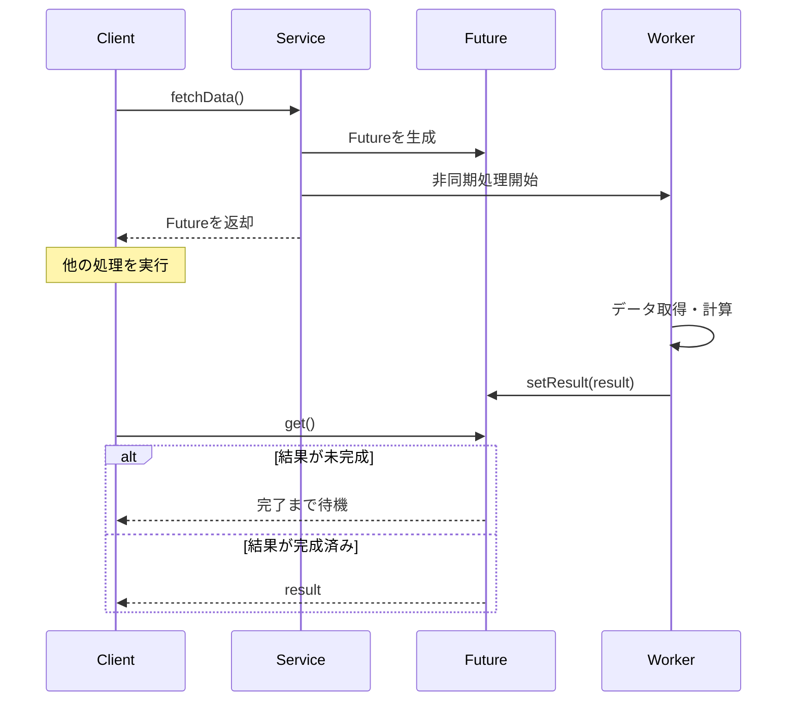
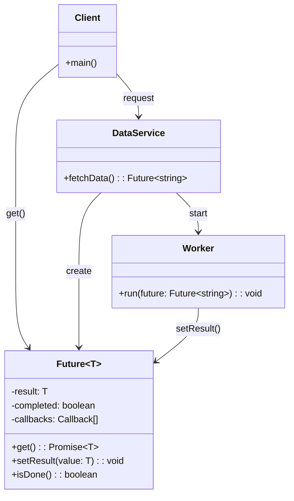

# Futureパターン

## Components

- `Client`: Futureを受け取り、必要なタイミングで結果を取得する
- `Service`: 非同期処理を開始し、すぐにFutureを返す
- `Worker`: バッググラウンドで処理を行い、完了したらFutureへ結果を設定する
- `Future`: 処理結果を保持し、利用者が後から取得できるようにする

## Sequence Diagram

## Class Diagram

